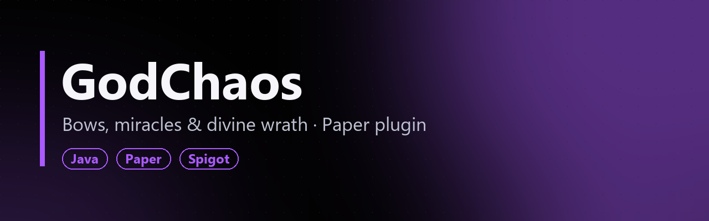
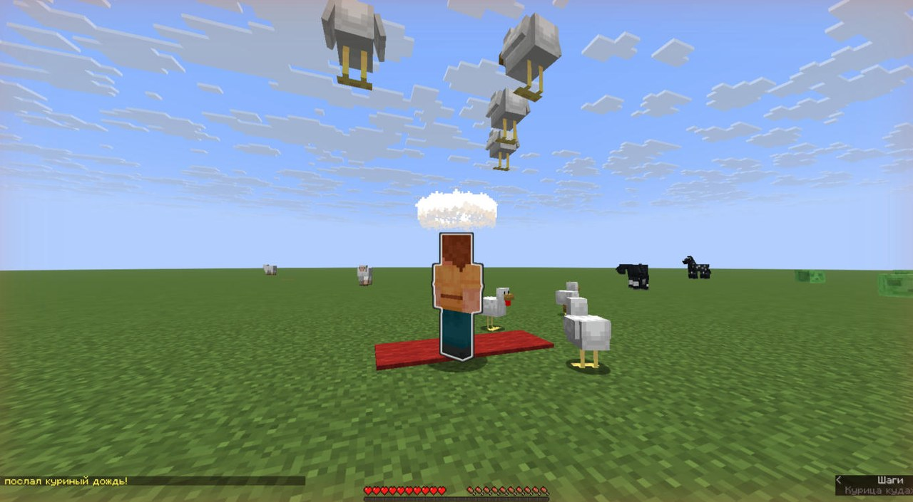

**[Русский](#русский) · [English](#english)**

> 🔒 Исходный код закрыт. В репозитории только описание плагина.
> 🔒 Source code is private. This repo contains a showcase only.

### Скриншоты с тестового сервера / Test server screenshots

_`/chudo chickens` на Paper 26.1.2 / on Paper 26.1.2._

---

## Русский

**GodChaos** — плагин-компаньон к [GodGreet](https://github.com/Zhopaa/godgreet-minecraft). GodGreet делает торжественный заход, а GodChaos отвечает за приколы вокруг «БоГа» всё остальное время. Paper/Spigot, Minecraft 26.1.2.

### Возможности
- **«Аминь».** Реплика БоГа улетает титрами на весь экран под колокол, и игроки по очереди сами пишут «Аминь!». Есть антиспам.
- **Автопоклон и запрет пялиться.** Подошёл ближе 5 блоков, и тебя наклоняет в поклон. Смотришь в упор дольше 3 секунд, и тебя ослепляет. Учитывается прямая видимость, так что сквозь стены это не работает.
- **Поклоны.** `/poklon`, `/poklon wave` (волна от ближних к дальним), цепная реакция между соседями. Глубина поклона зависит от расстояния. Есть топ самых преданных в `/poklony`.
- **Чудеса.** `/chudo` запускает рулетку: куриный дождь, левитация, взлёт предметов, внезапная ночь и другие.
- **Гнев БоГа.** `/kara <ник>`: молния, подброс в воздух и сообщение на весь сервер.
- **Грехи.** Слово «бог» со строчной буквы в чате наказывается, почтительное «БоГ» нет. Ломать блоки рядом с БоГом нельзя, 15% добытой руды уходит ему как десятина, смерть рядом с ним отмечается салютом.
- **Перевёрнутое управление.** `/troll <ник>` разворачивает смещение, которое прислал клиент. Есть предохранители от застревания в блоках и конфликтов с телепортами.

---

## English

**GodChaos** is a companion to [GodGreet](https://github.com/Zhopaa/godgreet-minecraft). GodGreet handles the grand entrance, and GodChaos handles the rest of the time with gags around the "God" player. Paper/Spigot, Minecraft 26.1.2.

### Features
- **"Amen".** The God's chat line flies across the screen as a title with a bell sound, and every player auto-replies "Amen!" in turn. Includes anti-spam.
- **Auto-bow and "don't stare".** Get within 5 blocks and you bow automatically. Stare at the God for more than 3 seconds and you're blinded. It checks line of sight, so walls block it.
- **Bows.** `/poklon`, `/poklon wave` (a wave from nearest to farthest), and chain reactions between neighbors. Bow depth depends on distance. `/poklony` shows a top-10 of the most devoted.
- **Miracles.** `/chudo` spins a roulette: raining chickens, levitation, items flying up, sudden night and more.
- **Divine wrath.** `/kara <player>`: lightning, a launch into the air and a server-wide announcement.
- **Sins.** A lowercase "god" in chat gets punished, while the reverent "БоГ" form doesn't. Breaking blocks near the God is blocked, 15% of mined ore goes to them as a tithe, and dying near them is celebrated with fireworks.
- **Inverted controls.** `/troll <player>` mirrors the movement delta the client sends. Safeguards prevent getting stuck in blocks and clashing with teleports.
